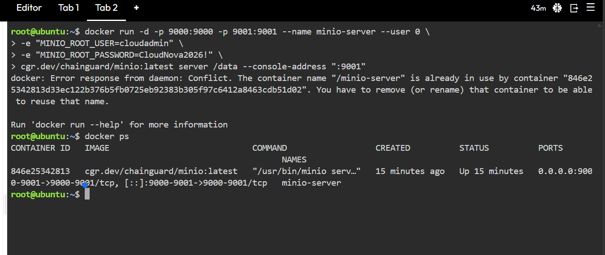

# MinIO Deployment

## Docker Command Used

```bash
docker run -d -p 9000:9000 -p 9001:9001 --name minio-server --user 0 \
-e "MINIO_ROOT_USER=cloudadmin" \
-e "MINIO_ROOT_PASSWORD=CloudNova2026!" \
cgr.dev/chainguard/minio:latest server /data --console-address ":9001"
```

> Note: The activity sheet uses `minio/minio`, but that image could not be pulled (`pull access denied`), and `quay.io/minio/minio` also failed (`unauthorized`). I used the `cgr.dev/chainguard/minio` image instead. The `--user 0` flag runs the container as root to avoid permission errors on the `/data` folder.

Verify the container is running:

```bash
docker ps
```

Screenshot: 

## Deployment Details

| Item | Value |
|---|---|
| Container name | `minio-server` |
| Image | `cgr.dev/chainguard/minio:latest` |
| API port | 9000 |
| Web console port | **9001** |
| Bucket created | **client-photos** |
| Uploaded file | (write the name of the file you uploaded) |

## Accessing the Web Console

1. In the KillerCoda Playground, I opened the **Traffic / Ports** tab.
2. I entered port `9001` and clicked **Access** to open the MinIO Web Console in a new browser tab.
3. I logged in with the username `cloudadmin` and the password defined in the Docker command.
4. I went to **Buckets**, clicked **Create Bucket**, and named it `client-photos`.
5. I opened the bucket and used the **Upload** button to upload a sample file.

Screenshot: 

## What the `-e` Flags Did

The `-e` flag sets **environment variables** inside the container when it starts.

- `MINIO_ROOT_USER=cloudadmin` set the administrator username used to log in to MinIO.
- `MINIO_ROOT_PASSWORD=CloudNova2026!` set the administrator password for that account.

Without these variables, MinIO would use its default credentials, which are insecure. Setting them at startup lets the container be configured without changing the image.
